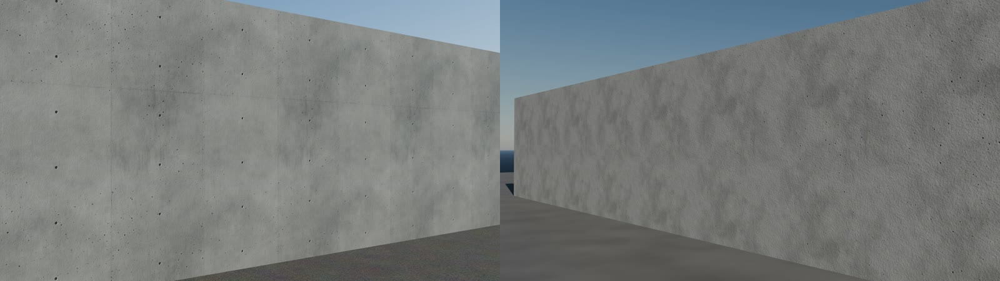

<p align="center"></p>

<p align="center">28 tested Blender skills for AI coding agents: Claude Code, Codex, OpenCode, Gemini CLI, Copilot, Cursor.</p>

<p align="center">
  <a href="https://github.com/EL4CTEO/blender-skills/releases"></a>
  <a href="https://github.com/EL4CTEO/blender-skills/actions/workflows/ci.yml"></a>
  <a href="LICENSE"></a>
</p>

The full 3D pipeline as Agent Skills: modeling, UVs, texturing, baking, rigging, animation, clothing, hair, environments, toon, optimization, export, rendering, video, weather, simulation and QA. Every script is tested in a real Blender.

**Requires** Blender 5.2 LTS or newer (verified on 5.3). A Blender MCP server is optional: with one, agents work in your open Blender; without, they run Blender in the background.

## Install

**Claude Code**
```
/plugin marketplace add EL4CTEO/blender-skills
/plugin install blender-agent-skills@blender-agent-skills
```

**Any agent**
```bash
git clone https://github.com/EL4CTEO/blender-skills
./blender-skills/install/install.sh        # macOS / Linux
.\blender-skills\install\install.ps1       # Windows
```
Installs to `~/.claude/skills` and `~/.agents/skills` (read by Codex, OpenCode, Gemini CLI, Copilot, Cursor). Options: `--agent claude|codex|opencode|gemini|copilot|cursor|all`, `--project DIR`, `--skills a,b`, `--uninstall` (PowerShell: `-Agent`, `-Project`, `-Skills`, `-Uninstall`).

## Skills

| Skill | What it does |
|---|---|
| `blender-core` | Start here: runs code, routes tasks, 5.x API rules |
| `blender-scene-setup` | Units, naming, collections, asset libraries |
| `blender-hardsurface-modeling` | Bevels, booleans, weighted normals |
| `blender-sculpting` | Organic sculpting |
| `blender-retopology-uv` | Retopology, UVs, texel density |
| `blender-pbr-materials` | Correct PBR materials from textures |
| `blender-texturing` | Edge wear, grime, decals, trim sheets |
| `blender-texture-baking` | Normal, AO, curvature, ORM |
| `blender-geometry-nodes` | Procedural modeling from JSON |
| `blender-character-rigging` | Rigify, skinning, game skeletons |
| `blender-facial-shapekeys` | ARKit 52 blendshapes, visemes |
| `blender-animation` | Actions, mocap retargeting, loop checks, root motion |
| `blender-clothing` | Clothes that follow the body without clipping |
| `blender-hair-grooming` | Hair, fur, game hair cards |
| `blender-game-optimization` | Budgets, LODs, draw calls |
| `blender-export-pipelines` | Roblox, Unity, Unreal, Godot, web, USD |
| `blender-rendering` | Cycles, EEVEE, batch rendering |
| `blender-lighting-lookdev` | Studio lighting, HDRI, turntables |
| `blender-stylized-npr` | Toon/anime shading, outlines |
| `blender-environment-kits` | Terrain, forests, modular kits |
| `blender-video-editing` | Video editing, camera tracking |
| `blender-simulation` | Rigid bodies, cloth, fluids |
| `blender-time-of-day` | Golden hour, night, fog, mood lighting |
| `blender-weather-fx` | Rain, snow, wet streets, puddles, lightning |
| `blender-addon-development` | Blender extensions |
| `blender-pipeline-automation` | Batch jobs, file conversion |
| `blender-asset-qa` | Z-fighting, floating parts, normals, weights, textures |
| `blender-workflow-recipes` | Complete asset playbooks |

## Try it

> "Make a game-ready crate for Unreal with baked normals and LODs."
> "Rig this character with Rigify and export it to Unity with a walk cycle."
> "Make this street a rainy night with puddles and lightning."

## With vs without skills

Same model, same prompts: **[see the comparison](https://el4cteo.github.io/blender-skills/comparison/)**.

<a href="https://el4cteo.github.io/blender-skills/comparison/"></a>

## Development

```bash
python tools/validate_skills.py   # spec + token budget checks
python tools/run_tests.py         # 79 headless Blender tests (BLENDER_EXE to override)
```

## Sponsors

Free and open source. If it saves you time, [sponsoring](https://github.com/sponsors/EL4CTEO) keeps it maintained. Company sponsors get a logo and link here, no paid recommendations.

MIT License
